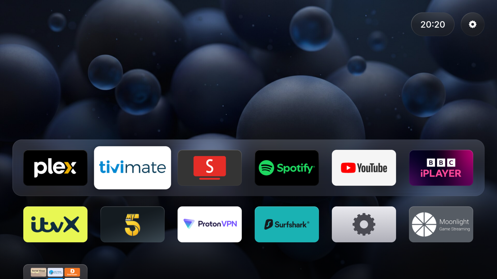
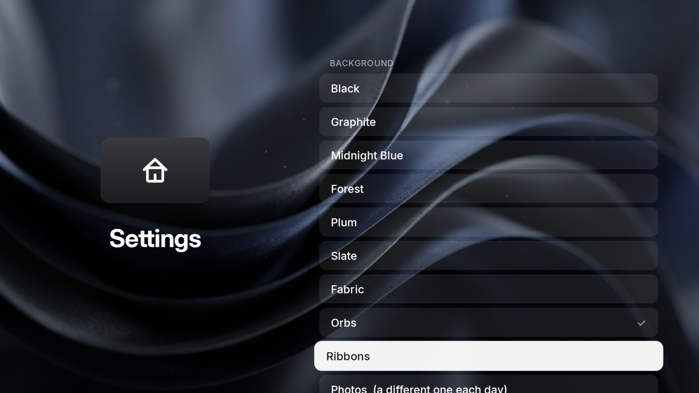

# Better TV

A fast, calm home screen for Android TV, styled after tvOS. Plain Java, no Gradle, no
third-party runtime libraries; the APK is about 2 MB, most of it the three built-in backgrounds.
Developed on a Google TV Streamer 4K.



## What it does

- App grid with a glass dock, focus lift and zoom-to-open; reorder, hide (More Apps folder),
  app info and uninstall from a long press.
- Weather pill with a 5-day forecast (Open-Meteo by default; no API keys).
- Backgrounds: solid dark colours, three built-in pictures (Fabric, Orbs, Ribbons), or your own
  photos from `Pictures/BetterTV` on the TV — one you pick, or a different one each day. Every
  choice previews full screen in Settings.
- One-page Settings behind the gear in the top-right corner.
- No ads, recommendations, news, accounts, analytics or crash reporting.



Cold start is about 0.7–0.9 s on the Streamer, navigation drops well under 1% of frames, and
nothing is redrawn while Home sits idle.

## Privacy

Better TV holds four permissions: internet and network state (weather), uninstalling apps (from
the long-press menu) and reading pictures (only for `Pictures/BetterTV`, and only if you choose
photos). It logs nothing about you. Network traffic is:

- **Weather**: the chosen service (Open-Meteo, MET Norway or wttr.in) gets your location rounded
  to about 1 km, every 15 minutes by default. The others are only tried if you allow it under
  Settings → Weather → *If the source is down*.
- **Location**: with *Use My Location*, one request a day to an IP-location service (ipapi.co,
  falling back to ipwho.is, then get.geojs.io) to find your town. Choosing a city instead
  (a search on Open-Meteo's geocoding service) avoids this entirely.

Its optional accessibility switch only watches the TV's own launcher, to open Better TV when the
Home button brings that up; it reads nothing in other apps.

## Install

**On the TV, with the Downloader app:** enter this address (it always serves the newest release):

```
https://github.com/pipetogrep/better-tv/releases/latest/download/better-tv.apk
```

**From a computer:** download the APK from [Releases](../../releases/latest), then:

```sh
adb connect <tv-ip>:5555
adb install -r better-tv-<version>.apk
adb shell cmd package set-home-activity dev.bettertv.launcher/.MainActivity
```

Needs Android 9 or later. Releases install over each other as updates.

On Google TV the remote's Home button may still open the stock launcher (or whatever a key
mapper such as tvQuickActions is set to). Either point that mapper's Home action at Better TV,
or turn on Settings → Home Button → *Home button opens Better TV*. Don't disable the stock
launcher; it isn't needed.

### Your photos

Your own photos are never bundled with the app. Put them on the TV:

```sh
adb shell mkdir -p /sdcard/Pictures/BetterTV
adb push photo.jpg /sdcard/Pictures/BetterTV/
```

Then choose them in Settings → Background (Better TV asks once for access to pictures).
They're shown at the resolution Android draws apps at (1920×1080 on the Streamer).

### Screensaver

Better TV never keeps the screen awake, so the TV's own screensaver (e.g. Aerial Views) starts
as configured. If it never does, check that Developer options → *Stay awake* is off.

## Build

Needs JDK 17+ and Android SDK build-tools 34.0.0 with platform android-34.

```sh
./build.sh                 # -> build/better-tv.apk
scripts/dev.sh run         # build, install on the TV and launch (TV=host:port); prints cold start
scripts/dev.sh perf        # frame stats while navigating, and frames drawn while idle
```

Versions number themselves: the version code is the commit count and the name is the latest
tag, so local builds and releases install over each other.

### Signing

`build.sh` signs with, in order:

1. `RELEASE_KEYSTORE` / `RELEASE_KEYSTORE_PASS` / `RELEASE_KEY_ALIAS` (GitHub Actions secrets);
2. `~/.config/bettertv/release.keystore` with its password in `~/.config/bettertv/keystore-password`
   (both `chmod 600`, never committed);
3. otherwise a throwaway `debug.keystore`, whose APKs won't install over a release.

`signing/lineage.bin` is public (certificates only): it records the move from the original
development key to the release key, so release builds update installs made before the move.
Keep a backup of `~/.config/bettertv`; without it, updates need an uninstall.

## Releases

`.github/workflows/build.yml` builds the APK on every push to `main` (download it from the
run's artifacts). Pushing a version tag publishes a release with the APK attached:

```sh
git tag v1.2.0 && git push origin v1.2.0
```

Pull requests build with a throwaway key; only the separate release job can publish. The build
fails if any picture other than the three built-in backgrounds ends up in the APK.

## License

Apache License 2.0. See [LICENSE](LICENSE) and [NOTICE](NOTICE) for attribution.
